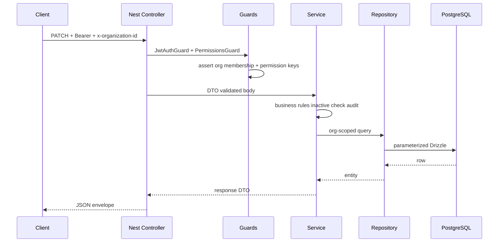

# GrubFleet ERP — Backend system inventory

**Audit date:** 2026-10-21  
**Repo:** `GrubFleet-ERP` (`apps/backend`, `packages/*`)  
**Purpose:** Phase 0 discovery artifact for production-readiness audit.

---

## Stack and runtime

| Component | Version / detail | Evidence |
|-----------|------------------|----------|
| Node | `>=20` (CI uses 22) | Root `package.json` `engines` |
| NestJS | `^11.0.1` | `apps/backend/package.json` |
| Drizzle ORM | `^0.45.3` | `apps/backend/package.json` |
| PostgreSQL | 16 (local Docker, CI service) | `docker-compose.yml`, `.github/workflows/ci.yml` |
| Redis | 7 (ioredis `^6.0.0`) | `docker-compose.yml`, `RedisModule` |
| Validation | `class-validator` + global `ValidationPipe` (whitelist, forbidNonWhitelisted, transform) | `bootstrap-app.ts` |
| Env validation | Zod `env.schema.ts` (production JWT secrets required when `APP_ENV=production`) | `config/env.schema.ts` |
| API prefix | `/api/v1` | `API_PREFIX` default |
| Deploy target | AWS Lambda via `@codegenie/serverless-express` | `lambda.ts` |
| Job queue | **None** (no BullMQ) | Grep: no matches in backend |

**Entry points**

- Local HTTP: `apps/backend/src/main.ts` → `createNestApplication()` → `listen(PORT)`.
- Lambda: `apps/backend/src/lambda.ts` — caches Nest app + serverless-express handler; `callbackWaitsForEmptyEventLoop = false`.

**Shared packages**

- `@grubpac/validation` — geo/postal/shared validators (built before lint/typecheck/test).
- `@grubpac/api-contracts`, `@grubpac/shared-types` — monorepo workspaces.

---

## Domain modules (Nest)

Registered in `app.module.ts`:

| Module | Path | Controllers (count) |
|--------|------|---------------------|
| Auth + Authorization | `modules/auth/` | 1 |
| Users | `modules/users/` | 1 |
| Organizations (tenant registry) | `modules/organizations/` | 1 |
| Permissions / Modules catalog | `modules/permissions/` | 2 |
| Roles | `modules/roles/` | 1 |
| Audit | `modules/audit/` | 1 |
| Organisation (locations, employees, suppliers, clients, drivers, location types) | `modules/organisation/` | 7 |
| Fleet leasing | `modules/fleet-leasing/` | 10 |
| Asset register | `modules/asset-register/` | 6 |
| Finance | `modules/finance/` | 4 |
| Inventory | `modules/inventory/` | 5 |
| Workshop | `modules/workshop/` | 4 |
| Health | `infrastructure/health/` | 1 |

**Not present in codebase:** Procurement module, standalone Administration HTTP module (administration flows use roles/users/permissions).

**HTTP route decorators (approx.):** ~180 `@Get/@Post/@Put/@Patch/@Delete` across 39 controller files (manual count 2026-10-21).

**OpenAPI:** `docs/api/openapi.yaml` — ~134 path entries (line count of `^\s+/` under `paths:`). **Drift:** more controller routes than documented paths (see main audit risk register).

---

## Cross-cutting infrastructure

| Concern | Implementation |
|---------|----------------|
| Database | Global `DatabaseModule`: `pg` `Pool` (`max: 10`, RDS SSL relax when needed) + Drizzle | `database.module.ts`, `pg-pool-options.ts` |
| Redis | `RedisModule`, injected as `REDIS_CLIENT` | Permission cache, login rate limit |
| Logging | `StructuredLoggerService`, correlation ID middleware | `app.module.ts`, `correlation-id.middleware.ts` |
| Errors | `GlobalHttpExceptionFilter` — validation details, Postgres mapping | `http-exception.filter.ts`, `postgres-error.util.ts` |
| Health | `GET /health` (liveness), `GET /health/ready` (PG + Redis + Drizzle) — **public** | `health.controller.ts` |
| Swagger | Only when `APP_ENV=development` at `/{API_PREFIX}/docs` | `bootstrap-app.ts` |
| CORS | Configurable origins; allows `x-organization-id` | `bootstrap-app.ts` |
| Security headers | **No `@nestjs/helmet` or equivalent observed** | Grep: no Helmet |
| Rate limiting | Login only (`LoginRateLimiterService`, Redis); disabled in `NODE_ENV=test`; **fail-open** if Redis errors | `login-rate-limiter.service.ts` |
| Graceful shutdown | `DatabaseModule.onModuleDestroy` → `pool.end()` | Local process only; Lambda reuses cached handler |

---

## Auth / RBAC model

```mermaid
flowchart LR
  Client[HTTP Client] -->|Bearer JWT| JwtGuard[JwtAuthGuard APP_GUARD]
  JwtGuard -->|@Public skip| Handler[Controller]
  JwtGuard --> PermGuard[PermissionsGuard APP_GUARD]
  PermGuard -->|resolve x-organization-id / query / body| AuthZ[AuthorizationService]
  AuthZ --> MemCheck[assertOrganizationAccess]
  AuthZ --> PermKeys[getEffectivePermissionKeys Redis cache]
  PermGuard --> Handler
  Handler --> Service[Domain Service]
  Service --> Repo[Module Repository Drizzle]
  Repo --> PG[(PostgreSQL)]
```

- **Global guards:** `JwtAuthGuard` (`auth.module.ts`), `PermissionsGuard` (`authorization.module.ts`).
- **Public routes:** `health/*`, `auth/login`, `auth/refresh`, `auth/logout` (`@Public()`).
- **Org context:** Header `x-organization-id` (primary), fallback `organizationId` query/body — `authorization.service.ts`.
- **Permission cache:** Redis + org revision bump on role mutations (`PermissionCacheService`, rule `14`).
- **Delegation:** Module access matrix utilities (`module-access.util.ts`); tested in `rbac.integration.spec.ts`.

---

## Database and migrations

- **Schema:** `apps/backend/src/database/schema/` (Drizzle).
- **Migrations:** `apps/backend/drizzle/*.sql` with journal `drizzle/meta/_journal.json` — **44** tagged migrations (0000–0043 including `0042_organisation_drivers_license_unique`, `0043_lease_contract_asset_class_id`).
- **Raw SQL:** Parameterized Drizzle `sql` fragments in seeds/health; no ad-hoc string-concat SQL in hot request paths observed in sample grep.

---

## CI / local dev

| Item | Detail |
|------|--------|
| CI | `.github/workflows/ci.yml` — Postgres 16 + Redis 7 services, migrate, lint, typecheck, test, build, Lambda verify |
| Local data tier | `docker-compose.yml` — Postgres + Redis only (app on host) |
| Integration tests | Jest `*.integration.spec.ts` — real DB (default `DATABASE_URL` localhost); `SKIP_DB_INTEGRATION=1` skips |
| Pre-push | Root `npm run ci:local` documented in rules |

---

## Integration test map

| Spec file | Domain |
|-----------|--------|
| `auth.integration.spec.ts` | Login/refresh/logout |
| `rbac.integration.spec.ts` | Roles, permissions, delegation |
| `organisation.integration.spec.ts` | Locations, employees, types |
| `organisation-suppliers.integration.spec.ts` | Suppliers |
| `organisation-clients.integration.spec.ts` | Clients |
| `organisation-drivers.integration.spec.ts` | Drivers |
| `fleet-leasing.integration.spec.ts` | Fleet clients, contracts, support |
| `asset-register-*.integration.spec.ts` (5 files) | Classes, vehicles, assignments, compliance, retired master |
| `finance-*.integration.spec.ts` (3 files) | Invoices, vendor payments, client statements |
| `inventory.integration.spec.ts` | Inventory |
| `workshop.integration.spec.ts` | Workshop |

**No dedicated integration specs:** `users`, `organizations`, `permissions/modules`, `audit` (partial coverage via RBAC/auth specs).

---

## Request flow (typical org-scoped mutation)



---

## Performance / load testing

- **Documented:** `docs/testing/load-testing.md` exists.
- **Audit execution:** k6/load scripts **NOT EXECUTED** (no local API soak run in this audit pass; optional future smoke).

---

## Related document

Full verdict, risk register, and go-live checklist: [`backend-production-readiness-2026-10-21.md`](./backend-production-readiness-2026-10-21.md).
